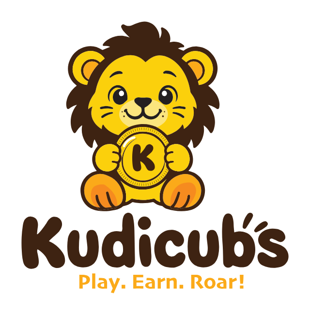
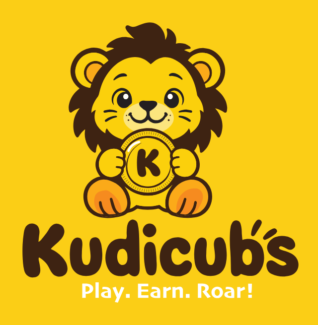
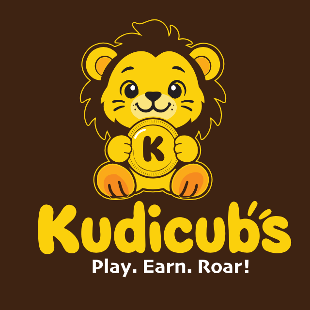
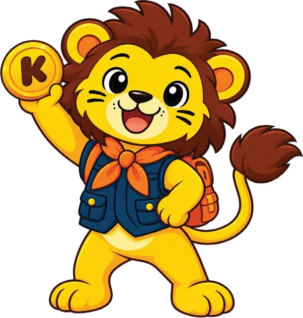
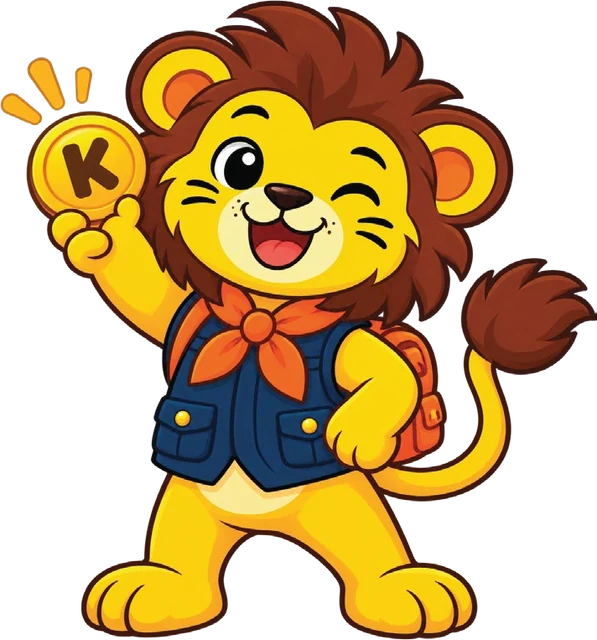
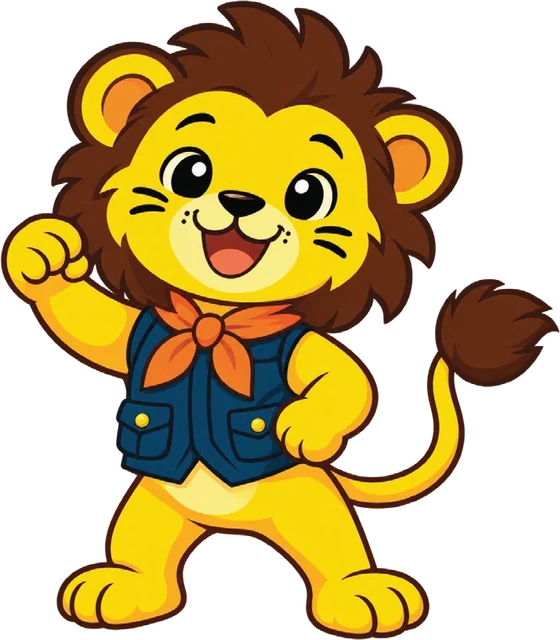
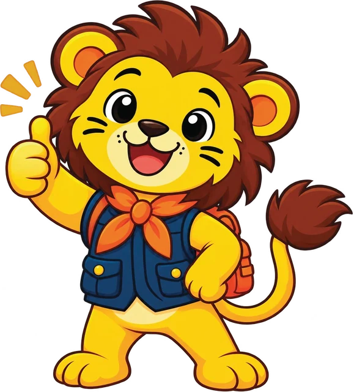
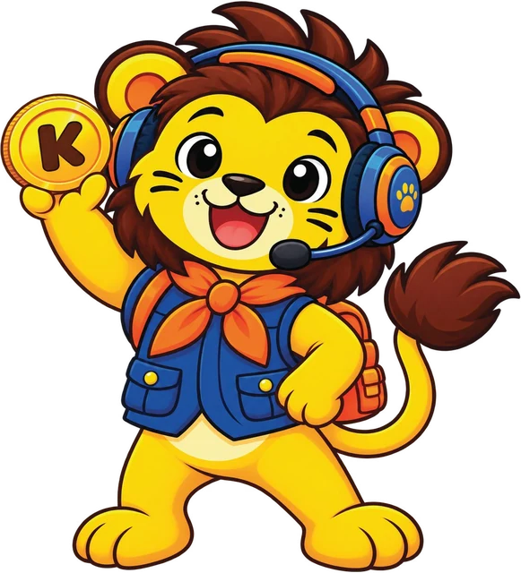

# KudiCubs Brand in the App

**Source**: the client's brand guide, `docs/source/KudiCubs Brand.pdf`.

**Applied in**: prototype v0.2.0 and tokens v0.2.0 (spec 003).

Everything here comes from the brand guide. Where the guide was silent or unclear, the choice is
marked **⚠ open**: it is proposed by us and waiting for the client.

## 1. Logo

| Version | File | Use it on | Where in the prototype |
|---|---|---|---|
|  | `prototype/assets/brand/logo-on-white.svg` | White | Welcome (hero), child-screen header (white header bar) |
|  | `logo-on-yellow.svg` | Sunshine Yellow only | The app icon (cub + coin crop) |
|  | `logo-on-brown.svg` | Mane Brown only | Parent gate, reviewer menu, grown-up header |

**Rules:**

- **Never redraw, recolour, stretch, crop into or re-type the logo.** The files are exported
  from the guide as vector artwork. Only the outer frame (the SVG `viewBox`) was set, and
  `tools/design/extract-brand-assets.mjs` verifies the artwork is unchanged.
- **Clear space:** at least the height of the "K" coin all round.
- **Minimum size:** 120 px wide. The header uses 48 px tall, the smallest practical size.
  Request a simplified header mark if the client wants one (⚠ open).
- **⚠ B1, yellow version tagline:** the approved yellow logo sets "Play. Earn. Roar!" in
  **white on Sunshine Yellow (1.51:1)**. Logos are exempt from contrast rules (WCAG 1.4.3), so
  we use it as supplied. We prefer the White or Mane Brown versions wherever the background
  allows. Ask the client whether a Mane Brown tagline variant exists.
- **⚠ B7, product name:** the wordmark reads "Kudicub's" and the guide's text says "Kudicubs".
  App text uses "KudiCubs" (spec 001) until the client decides.
- **⚠ B8, master files:** these files come from the PDF. Ask for the vector logo and transparent
  mascot masters for production.

## 2. Kudi the Cub: the five supplied poses

Only these five images are used. **No new or modified cub artwork.** They are recombined from
the guide's own images and transparency masks, and scaled in proportion.

| Pose | Image | State (spec 003 FR-010, FR-025) |
|---|---|---|
| `wave` |  | Greeting; the base pose on most screens; think; welcome back after a long idle |
| `celebrate` |  | A step done, Reward. **⚠ B2: the client asked for a "peace sign" pose, but none of the five shows one.** This "wink with a sparkling coin" pose is used until the client confirms or supplies one. |
| `fist` |  | Encourage: try again, idle hints |
| `thumbs-up` |  | Correct |
| `headphones` |  | While a recorded line is playing |

**Pose order** for one action: the reaction pose for about 0.6 s, then `headphones` while the
line plays, then back to the screen's base pose
([interaction-moments §2](../../specs/003-brand-voice-interactive/contracts/interaction-moments.md)).

## 3. Colour

The tokens are in [tokens.md](./tokens.md), and the full contrast check is in
[contrast-report.md](./contrast-report.md).

| Guide recommendation | In the app |
|---|---|
| Main buttons: **Sunshine Yellow** `#FBCE16` | `primary-button` fill, with a **Mane Brown label and a 2 px Mane Brown outline** |
| Secondary buttons: **Adventure Orange** `#F68C1F` | `secondary-button`, `replay-button`, speaker cue, level badge: always a Mane Brown label or icon, plus an outline |
| Headings, borders and outlines: **Mane Brown** `#3E2312` | All text, outlines, coin rims, the hint ring, count badges, the phone frame |
| Main backgrounds: **Warm Cream** / **White** | App background `#FEF5E0` (**⚠ B4 provisional**; the guide prints `#F68C1F` by mistake); cards and the header are White |
| Coins and reward icons: **Golden Orange** `#FBAA19` | Coin faces, the XP fill, reward icons: always with a Mane Brown rim |
| Character highlights: **Soft Gold** `#FBE57E` | **Kudi's speech bubble and the selected choice-card fill**. This is what "character highlight" means here. |
| Success messages: *a separate accessible green, not part of the palette* | `color.success.green` **`#16793A`**, **⚠ B3 pending approval**: 5.05:1 on Warm Cream, 5.48:1 on White, 5.48:1 with white text. Used only on cream or white. |
| Peach Cream `#FCE6C6` | Panels and locked cards |
| Charcoal | `#231F20` (**⚠ B5 assumed**: the guide prints `#000000`, the swatch shows `#231F20`). Reserved, not used for UI text. |

**Rules:**

- **Text on Sunshine Yellow, Adventure Orange or Golden Orange is always Mane Brown, never
  white.** White on yellow is 1.51:1 and white on orange is 2.42:1; both fail.
- **Every yellow or orange control, coin and reward icon on a light background has a Mane Brown
  outline or rim.** These colours alone don't stand out enough against cream or white: 1.39–2.23:1
  against the 3:1 needed.
- **No brand colour value was ever changed.** Where a pairing failed, we used a different brand
  pairing, or didn't use that pairing.
- **⚠ B6, derived shades** (all pending approval):
  - Pressed states: yellow `#E4B916`, orange `#DA7C1D`, golden `#E49A18`.
  - Secondary text: brown 80% `#644D3B`.
  - Locked text: brown 60% `#8B7764`, large text only.
  - Trays: cream shade `#F2E8D4`. Pressed cards: peach shade `#EDD6B8`.

  Each one is a mix of a brand colour with Mane Brown or Warm Cream. No new hues.
- **⚠ B10, illustration palette** (placeholder art only, never UI): coin metals (silver, bronze),
  coin flag accents (Ghana red and green, Nigeria green, UK navy), and nature greens and greys
  for scenes and avatars. They're recorded as `color.illustration.*`, each marked
  `needsApproval`, and checked by `check-brand.mjs --art`. Supplied brand art (the logo and
  mascots) is exempt.

## 4. Typography

| Use | Font | Licence |
|---|---|---|
| Logo | **Sobas Play**, inside the logo artwork only | Not embedded, so no licence is needed |
| Tagline | **Skia**, inside the logo artwork only | Not embedded; it's an Apple system font and can't be shipped on Android or the web anyway |
| **UI: titles, numbers, buttons** | **Baloo 2** (proposed) | SIL Open Font License 1.1: free for apps, web, Android and iOS |
| **UI: body text** | **Nunito** (proposed) | SIL Open Font License 1.1 |

**⚠ B9, UI font proposal:**

- Sobas Play is a heavy, rounded, playful display face. Baloo 2's rounded heavy weights echo it,
  so titles and buttons feel like the logo without copying it.
- Nunito's rounded ends keep body text soft and very easy to read for early readers, and its
  open shapes sit well next to Skia.
- Both are already bundled and include the ₵, ₦ and £ glyphs.
- If the client would rather use Sobas Play for headings, its licence must allow app and web
  embedding first.

## 5. Open decisions for the client

| # | Decision | Our proposal |
|---|---|---|
| B1 | The yellow logo's white tagline (1.51:1) | Use it as supplied; prefer the White and Mane Brown versions; ask whether a Mane Brown tagline exists |
| B2 | No peace-sign pose | Use the "wink with a sparkling coin" pose for celebrate, or the client supplies a peace-sign pose |
| B3 | The success green | `#16793A` |
| B4 | Warm Cream | `#FEF5E0` (the swatch value) |
| B5 | Charcoal | `#231F20`, reserved |
| B6 | Derived shades | As listed in §3 |
| B7 | Product name in text | KudiCubs, Kudicubs or Kudicub's |
| B8 | Master files | Vector logo and transparent mascots |
| B9 | UI fonts | Baloo 2 + Nunito (OFL) |
| B10 | Illustration palette for placeholder art | As recorded in `tokens.json → color.illustration` |
| B11 | App icon | The cub-and-coin crop of the approved yellow logo, or the full yellow logo if declined (FR-009 exception) |
| V1 | First recording language | Ghanaian English |
