# KudiCubs Components

This page lists **28 components**: the 25 in spec 002 FR-004, plus 3 added in round 1 (spec 003): `replay-button`, `narration-caption` and `count-badge`. Since round 1 they use the official brand ([brand.md](./brand.md)). Every element in the prototype carries
`data-component="<id>"` and is one of these. That is checked by `tools/design/tests/flow.spec.mjs`.

- The thumbnails come from the prototype (`node tools/design/capture-components.mjs`).
- The styles are in `prototype/assets/components.css`.
- Every value comes from [tokens](./tokens.md).

## One main action at a time

Constitution I says every screen has **exactly one obvious primary action**. In KudiCubs that is
always exactly one of these two:

| Marker | What it is | Example |
|---|---|---|
| `data-primary` | One main button | Let's Go, Start, Next, Back to Home |
| `data-primary-group` | One group of *equal* choices or activity targets, used while a choice or activity is in progress | The two Save/Spend cards; the age cards; the coins to find, sort or count |

**Child actions** (round 1): every tap or drag target that isn't the main action carries `data-child-action` (`hear`, `answer`, `drag`, `tap`, `find` or `count`). Child actions **never navigate and are never `data-primary`**, so the one-main-action rule still holds. They are enabled the moment a screen appears, and each one makes Kudi react and plays a sound or line ([interaction-moments](../../specs/003-brand-voice-interactive/contracts/interaction-moments.md)).

When the child makes the choice or finishes the activity, the group stops being the main action
and **a single main button replaces it**. So the child always sees one obvious thing to do. The
idle hint (`gentle-hint`) always pulses whichever of the two is current.

**Band notes** in each section give how the component changes from 4–6 to 13–15. They follow
[age-band-rules.md](./age-band-rules.md).

---

### 1. `primary-button`

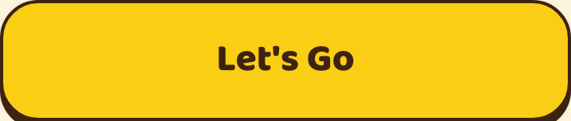

- **Purpose**: the one main action on a screen.
- **States**: default · pressed (sinks 4 px onto its gold.600 edge) · disabled (50% opacity) ·
  `hint` (teal pulsing ring).
- **Minimum touch size**: full width × 76 (4–6) or × 64 (other bands).
- **Tokens**: `color.action.primary.*` (Sunshine Yellow, Mane Brown label, **2 px Mane Brown outline**), `typography.button_4_6` / `button`, `radius.lg`, `size.button.height_4_6`.
- **Screens**: every screen.
- **Bands**: 4–6 uses one word or two plus an optional icon. Older bands may use short phrases.

### 2. `secondary-button`

- **Purpose**: a less important action that must never compete with the main one.
- **States**: default · pressed.
- **Minimum touch size**: 48 high.
- **Tokens**: `color.action.secondary.*` (Adventure Orange, Mane Brown label and outline), `typography.label`.
- **Screens**: reviewer menu (Restart). In the app: parent area, "Maybe later".
- **Bands**: never on 4–6 child screens beside a main button.

### 3. `icon-button`

- **Purpose**: a round control with an icon only: back, close, and the KudiCubs logo (hold for 2
  s to open the reviewer menu).
- **States**: default · pressed · `is-pressing` (logo long-press ring).
- **Minimum touch size**: 48 × 48. Needs an `aria-label`.
- **Tokens**: `radius.pill`, `color.bg.card`.
- **Screens**: every screen's header, reviewer menu.
- **Bands**: same in every band.

### 4. `choice-card`

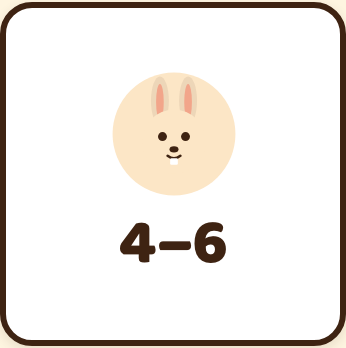

- **Purpose**: one of 2–3 equal choices (age, avatar, name chip, Save/Spend).
- **States**: default · selected (gold.600 border, raised) · locked ("Coming soon", cocoa.500) ·
  wiggle (when a locked card is tapped) · `hint`.
- **Minimum touch size**: 64 × 64.
- **Tokens**: `color.white`, `radius.md`, `elevation.1/2`, `typography.button`.
- **Screens**: `age-select`, `avatar`, `decision`.
- **Bands**: 4–6 shows a picture first, at most 3 words, exactly 2 cards on Decision. 7–15 may
  show 3 cards and a short sentence.

### 5. `speaker-cue`

- **Purpose**: shows that a line is spoken; tap it to hear the line again (FR-015).
- **States**: default · speaking (pulse).
- **Minimum touch size**: 48 × 48.
- **Tokens**: Adventure Orange with a Mane Brown icon and outline (5.98:1). Never a white icon.
- **Screens**: every child screen.
- **Bands**: every band. 4–6 plays automatically; 10+ plays on tap.

### 6. `kudi-bubble`

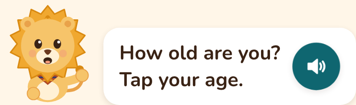

- **Purpose**: Kudi the Cub plus a speech bubble with the spoken prompt and its speaker cue.
- **States**: one per Kudi pose ([kudi-the-cub.md](./kudi-the-cub.md)). Kudi switches to `point`
  during idle hints and to `gentle` after a wrong jar.
- **Minimum size**: Kudi is at least `size.kudi.min` (96).
- **Tokens**: `color.character.highlight` (Soft Gold) bubble with a Mane Brown border, `radius.md`, `typography.body_child`. Kudi is one of the five official poses ([kudi-the-cub.md](./kudi-the-cub.md)).
- **Screens**: most child screens.
- **Bands**: 4–6 on every screen. Fewer screens as the bands get older.

### 7. `illustration`

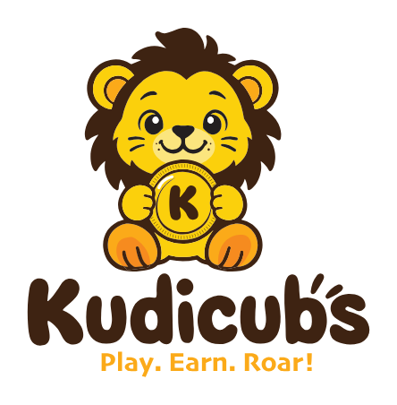

- **Purpose**: a wrapper for scene art, a Kudi shown without a bubble, and decorative pictures.
  Decorative ones are `aria-hidden`.
- **States**: none.
- **Minimum size**: n/a (not interactive).
- **Tokens**: `radius.md` for scenes.
- **Screens**: `welcome`, `home`, `mission-intro`, `activity-find`, `summary`, `wallet`.
- **Bands**: same in every band.

### 8. `coin-counter`

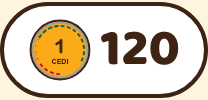

- **Purpose**: shows an amount of in-game coins as **the region's coin picture plus a number**,
  never a price such as "GH₵120" (FR-022). It carries `data-money` and `data-region`.
- **States**: default · signed (+ or −).
- **Minimum size**: n/a.
- **Tokens**: `typography.display_*`, `space.6–10` icon sizes.
- **Screens**: `home`, `wallet`, `result-*`, `reward`.
- **Bands**: 4–6 always uses the coin picture. Older bands may add currency words in labels.

### 9. `xp-bar`

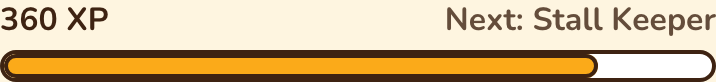

- **Purpose**: progress toward the next level. The same component draws the pillar bars.
- **States**: default · filling (animated).
- **Minimum size**: n/a.
- **Tokens**: `color.reward.coin` (Golden Orange) fill on White with a Mane Brown outline, `radius.pill`.
- **Screens**: `home`, `progress`.
- **Bands**: 4–6 shows the bar and the next level's name. Older bands also show XP numbers.

### 10. `level-badge`

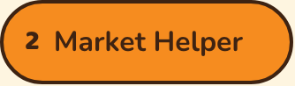

- **Purpose**: the current level number and name (for example "2 Market Helper").
- **States**: default.
- **Minimum size**: n/a.
- **Tokens**: `color.action.secondary.bg` (Adventure Orange) with a **Mane Brown** label and outline (5.98:1), `radius.pill`.
- **Screens**: `home`.
- **Bands**: level names come from each world (spec 001 FR-026).

### 11. `streak-daily`

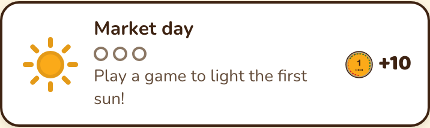

- **Purpose**: the **daily sun**: today's market-day challenge and its progress dots.
  **There is never a penalty or "streak lost" state** for 4–6 (FR-018).
- **States**: default · complete.
- **Minimum size**: 48 for the card's speaker cue.
- **Tokens**: White card with a Mane Brown border; the sun is Golden Orange.
- **Screens**: `home`.
- **Bands**: 7–15 may show a gentle "come back tomorrow" line, but never a loss.

### 12. `badge-tile`

- **Purpose**: one skill badge.
- **States**: earned · locked (grey, 35%) · new (pop animation).
- **Minimum touch size**: 48 wide.
- **Tokens**: `space.16` icon, `typography.caption`.
- **Screens**: `home` (preview), `reward`, `progress`.
- **Bands**: same in every band.

### 13. `jar`

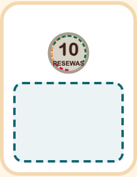

- **Purpose**: a sorting and counting jar, labelled with **one coin picture** (no words).
- **States**: default · target (a coin is picked) · `hint` (teal glow after 2 wrong tries) ·
  done (green border plus the count).
- **Minimum touch size**: 64 or more.
- **Tokens**: White with a Mane Brown border; the glass is dashed Mane Brown on Warm Cream; the target is Soft Gold; done is the success green; `radius.md`.
- **Screens**: `activity-sort`, `activity-count`.
- **Bands**: 4–6 counts coins. Older bands may total values.

### 14. `coin-token`

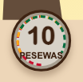

- **Purpose**: one stylised coin or note for the region. It can be tapped, dragged, sorted and
  counted.
- **States**: default · picked · dragging · `gentle` (bounce back, never red) · found (spins
  away) · counted (faded).
- **Minimum touch size**: 50 (find scene) and 56 elsewhere.
- **Tokens**: `size.coin`, `radius.pill`.
- **Screens**: `activity-find`, `activity-sort`, `activity-count`.
- **Bands**: denominations come from the region (research D7).

### 15. `progress-dots`

- **Purpose**: "how many are left": one coin per dot, which lights up when found.
- **States**: off · on.
- **Minimum size**: n/a.
- **Tokens**: `space.6` icons.
- **Screens**: `activity-find`.
- **Bands**: 7+ may show "5 / 8".

### 16. `bottom-nav`

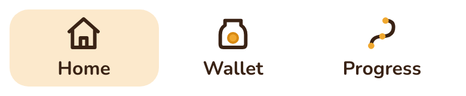

- **Purpose**: three icon tabs, Home · Wallet · Progress. Each label is spoken when tapped, in
  place of the screen's prompt, so it always finishes (003 FR-036).
- **States**: default · current.
- **Minimum touch size**: 64 high.
- **Tokens**: `color.white`, `radius.md`.
- **Screens**: `home`, `wallet`, `progress` only. It is never shown during a mission.
- **Bands**: same in every band.

### 17. `region-coin-set`

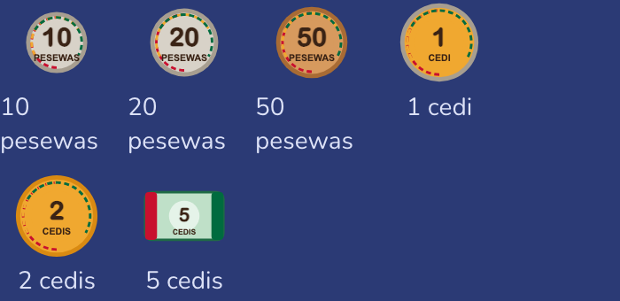

- **Purpose**: shows one region's coins and notes side by side (the reviewer menu; later, the
  parent region setting).
- **States**: one per region.
- **Minimum size**: n/a.
- **Tokens**: `space.12` coins.
- **Screens**: reviewer menu.
- **Bands**: n/a.

### 18. `parent-gate-pad`

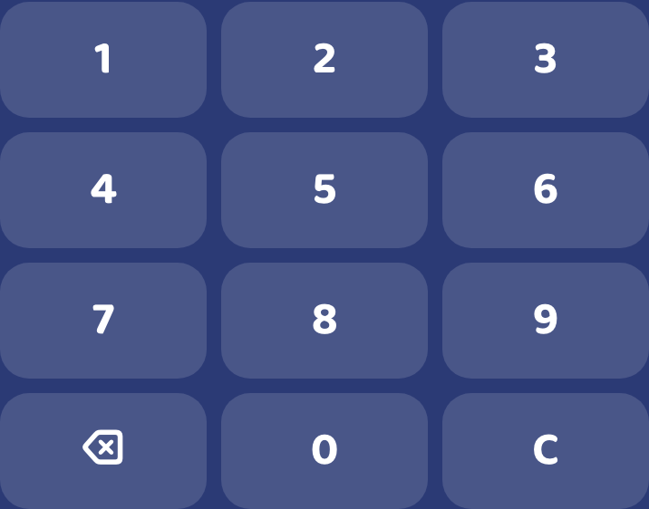

- **Purpose**: the number pad that answers the written multiplication ("eight times six").
- **States**: default · pressed.
- **Minimum touch size**: 64.
- **Tokens**: `color.parent.*` (Mane Brown, Warm Cream text), `typography.title`.
- **Screens**: `parent-gate`.
- **Bands**: parent only.

### 19. `pin-pad`

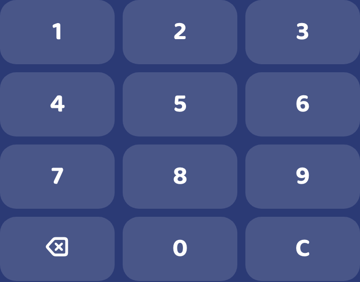

- **Purpose**: sets the 4-digit parent PIN, with dots for entered digits. Weak PINs (0000, 1234,
  repeated digits) are gently refused.
- **States**: default · pressed.
- **Minimum touch size**: 64.
- **Tokens**: `color.parent.*`, with filled dots in `color.parent.accent` (Sunshine Yellow).
- **Screens**: `parent-gate`.
- **Bands**: parent only.

### 20. `action-result`

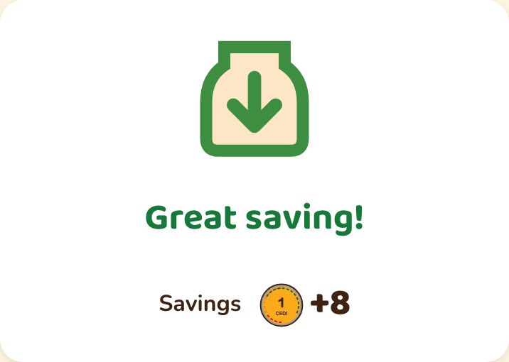

- **Purpose**: the outcome of a decision: animation, gain or change, and a positive message.
- **States**: save (coins fly to the jar) · spend (sticker unwraps). 7–15 add negative outcomes
  with a Try Again (spec 001 FR-029–031).
- **Minimum size**: n/a.
- **Tokens**: White card, `color.feedback.success` for the positive message (success green, pending approval).
- **Screens**: `result-save`, `result-spend`.
- **Bands**: 4–6 never shows a negative outcome; the gentle variant is used instead.

### 21. `bar-chart`

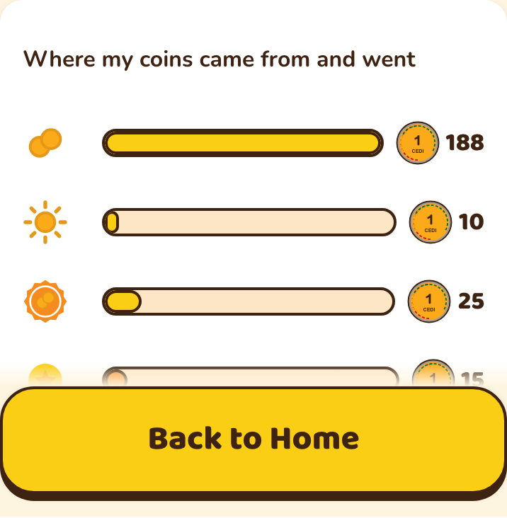

- **Purpose**: "where my coins came from and went", grouped by category with icons and numbers.
- **States**: default.
- **Minimum size**: n/a.
- **Tokens**: Sunshine Yellow (in), Adventure Orange (treats), success green (saved), `radius.pill`.
- **Screens**: `wallet`.
- **Bands**: 4–6 shows icons plus numbers. Older bands add labels and percentages.

### 22. `level-path-node`

- **Purpose**: one stop on the **market road** level path.
- **States**: done (green) · current (gold with a glow) · locked (padlock).
- **Minimum touch size**: 64.
- **Tokens**: `size.touch.primary_4_6`; current is Sunshine Yellow with a Mane Brown outline; done is the success green with white text.
- **Screens**: `progress`.
- **Bands**: same in every band; level names come from each world.

### 23. `celebration-overlay`

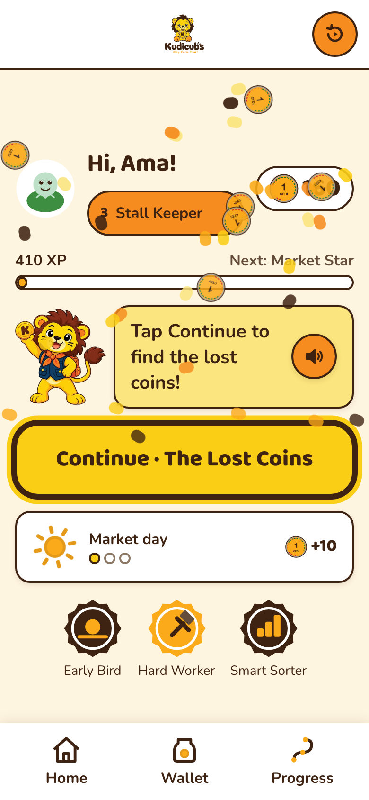

- **Purpose**: the coin-and-confetti burst on Reward and on "joined the Pride".
- **States**: playing · off (skipped entirely under `prefers-reduced-motion`).
- **Minimum size**: n/a (not interactive).
- **Tokens**: `motion.celebrate`, brand colours (yellow, orange, Golden Orange, Soft Gold), plus Golden Orange coins.
- **Screens**: `reward`, `parent-gate` (joined moment).
- **Bands**: same in every band; 13–15 may use a smaller version.

### 24. `gentle-hint` *(a state, not a separate element)*

- **Purpose**: the idle hint. A Mane Brown ring with a Sunshine Yellow glow pulses on the current
  main action (`data-primary` or `data-primary-group`), Kudi shows `fist` (encourage), and the
  prompt is spoken again.
- **States**: level 1 (at 6 s, prompt spoken) · level 2 (12 s, hint line) · level 3 (20 s, long
  idle: stronger pulse, Kudi `wave`, "Welcome back! Let's play!", FR-038).
- **Minimum size**: n/a.
- **Tokens**: `color.feedback.hint_ring` (Mane Brown) with a `color.feedback.hint_glow` (Sunshine Yellow) glow.
- **Screens**: every child screen.
- **Bands**: the first hint comes at 6 s (4–6), 8 s (7–9), 10 s (10–12) or 12 s (13–15).

### 25. `reviewer-menu`

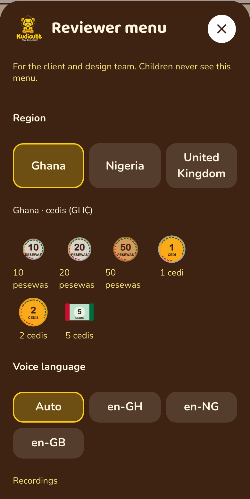

- **Purpose**: a hidden menu for the client and design team: region, jump to screen, sound,
  screen notes, restart, version. It **opens only with a 2-second hold on the logo** (or
  `?review=1`), and is never `data-primary`.
- **States**: open · closed.
- **Minimum touch size**: 48.
- **Tokens**: `color.parent.*` (Mane Brown) with the official logo on brown, `radius.xl`. It also has a **Voice language** control and shows how many lines are recorded.
- **Screens**: overlays every screen.
- **Bands**: n/a (reviewers only; not part of the app).

---

## New in round 1 (spec 003)

### 26. `replay-button`

- **Purpose**: replays the last line Kudi said on this screen (FR-029). Before anything has
  played, it plays the screen's first line.
- **States**: default · pressed.
- **Minimum touch size**: 48 × 48.
- **Tokens**: `color.action.secondary.bg` (Adventure Orange), a Mane Brown outline and replay
  icon.
- **Screens**: every screen (header, right).
- **Bands**: same in every band.

### 27. `narration-caption`

- **Purpose**: shows the words of the current line, with its status. It never covers the main
  action and never blocks taps.
- **States**:

  | State | Meaning |
  |---|---|
  | `playing` | A recording is playing; there's a pulsing dot and Kudi shows `headphones` |
  | `pending` | No recording yet: the **"Recording pending"** badge (FR-016) |
  | `ready` | A recording exists but the browser needs a tap first: "Tap ↻ to listen" |
  | `muted` | The sound is off |
  | `done` | The line has finished |
  | `hidden` | Nothing to show |

- **Minimum size**: a fixed two-line slot, so the layout never moves while a child is dragging.
- **Tokens**: White with a Mane Brown border; the badge is Mane Brown on Soft Gold.
- **Screens**: every child screen.
- **Bands**: same in every band. Captions are a reviewer and reader aid. Pre-readers rely on the
  recordings.

### 28. `count-badge`

- **Purpose**: how many coins are in a jar during sorting. It **goes up by exactly one per coin**,
  the moment the coin lands (FR-024).
- **States**: default · bump (a pop animation on each increase).
- **Minimum size**: n/a (not interactive).
- **Tokens**: a Mane Brown pill with a Warm Cream numeral (13.31:1).
- **Screens**: `activity-sort`.
- **Bands**: 4–6 counts coins. Older bands may show values.

## Round 2 (spec 004): layout states, not new components

- **Pinned action area** (`.kc-actions` inside `#kc-screen`): the main button sits in a sticky
  footer with a Warm Cream fade, so it is always fully in view at 360×640 and 390×844
  (FR-001). Short screens (`max-height: 700px`) use a smaller Kudi and smaller pictures, never
  smaller text or targets (FR-002).
- **Empty states** (FR-030): on a first visit Home, Wallet and Progress show a `kudi-bubble`
  invitation ("Let's find some coins!", "Play The Lost Coins to fill your jar!", "Play to earn
  your first badge!"). There are no blank charts or lists; badges stay as locked silhouettes.
- **Count jars**: on the Count screen the three `jar`s are rows, and their coins are 48×48
  `coin-token`s (FR-009).
- **Tap-to-hear words**: the row holding the words and their `speaker-cue` is the 48 px target
  (`.kc-tap-row`). A word on its own gets a 48 px box (`.kc-tap-word`).
- **Load-failure panel** (`#kc-boot-fail`, FR-051): Kudi, one line and a "Tap to try again"
  `primary-button`, written in plain HTML in `index.html` so it works when other files don't.
- **`narration-caption`**: hidden when its text is already on screen in Kudi's words (FR-008).
  The voice badge ("Scratch voice" / "Recording pending") shows only with reviewer notes on
  (FR-019).

