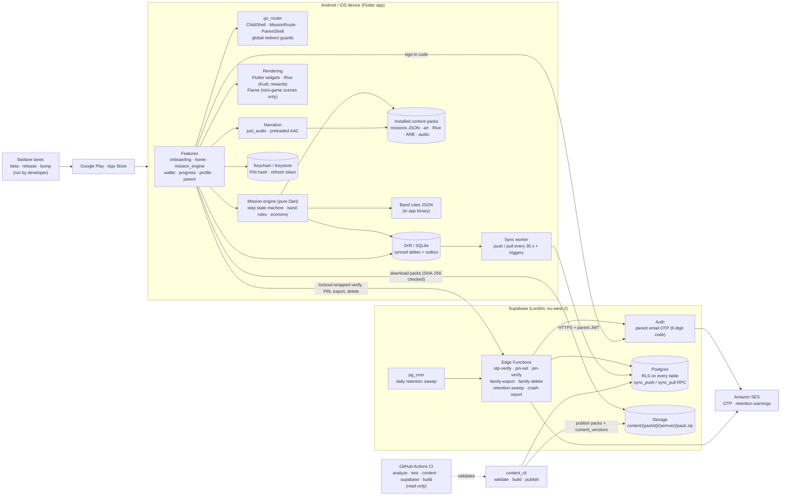
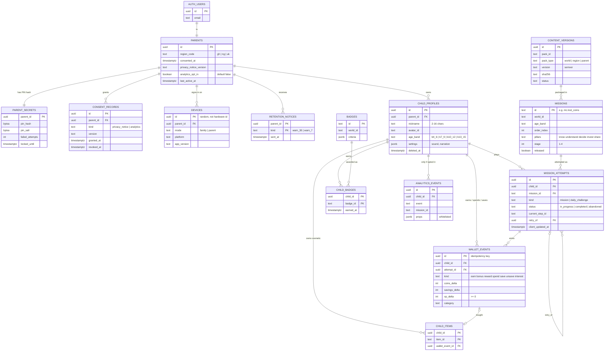
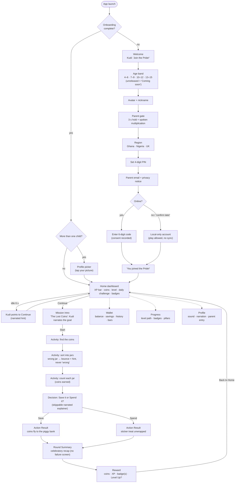
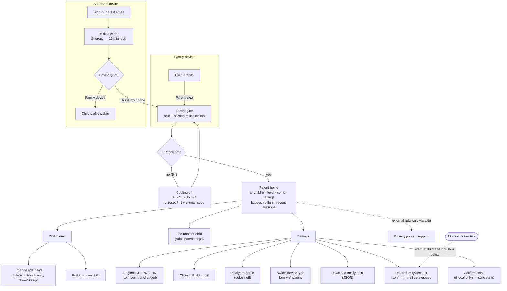
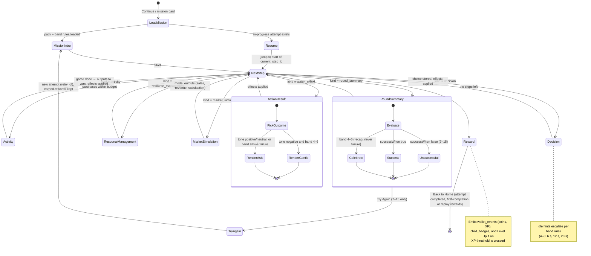

# KudiCubs: Architecture & Flow Diagrams

**Source of truth**:

- [specs/001-kudicubs-mvp/spec.md](../../specs/001-kudicubs-mvp/spec.md) (requirements)
- [specs/001-kudicubs-mvp/plan.md](../../specs/001-kudicubs-mvp/plan.md) (architecture)

**Version**: matches tag `v0.2.0-architecture`.

These diagrams summarise those documents. If a diagram and the spec or plan disagree, **the spec
and plan win** and this file should be updated. Requirement ids (FR-xxx) and research ids (Rxx)
point back to the sources.

1. [System architecture](#1-system-architecture)
2. [Data model (ER)](#2-data-model-er)
3. [Child user flow: launch / sign-in → Reward](#3-child-user-flow-launch--sign-in--reward)
4. [Parent flow](#4-parent-flow)
5. [Mission engine: screen-type state machine](#5-mission-engine-screen-type-state-machine)

---

## 1. System architecture

The client is local-first. The device's SQLite database is the source of truth for the UI, and
sync runs in the background (R12). The backend is Supabase, in the London region (R16, R22).
There are no third-party analytics, ads or crash SDKs (R19, R20).

---

## 2. Data model (ER)

These are the server tables from [data-model.md](../../specs/001-kudicubs-mvp/data-model.md) §2.

- Child data is limited to **nickname, avatar, age band and progress** (FR-005, FR-007f).
- Balances are always folded from `WALLET_EVENTS`, never stored (R10).
- `PARENT_SECRETS`, `OTP_ATTEMPTS` and `RETENTION_NOTICES` have no client access.

---

## 3. Child user flow: launch / sign-in → Reward

Children never have accounts or passwords. "Login" for a child means **first-time onboarding**
(the parent creates the family account inside it) or **picking their picture** on the profile
picker. The flow follows the thought paper's direction (Home → Continue → Mission Intro →
Decision → Result → Summary → Reward → Home), the onboarding order in FR-003, the guards in
[routes.md](../../specs/001-kudicubs-mvp/contracts/routes.md), and the 4–6 rules (no failure
screens).

---

## 4. Parent flow

The parent area is reachable only through the **gate challenge plus PIN** (FR-006, FR-036). It is
reached from Profile on a family device, or is the start screen on a parent device (FR-007h).

---

## 5. Mission engine: screen-type state machine

The engine runs a mission as a state machine over **six step kinds** plus two **engine-owned
framing screens** (Mission Intro, Reward). This follows FR-016 and FR-017 as amended, and the
mission schema in
[contracts/mission-content.schema.json](../../specs/001-kudicubs-mvp/contracts/mission-content.schema.json).

Band rules (R9) change behaviour at the marked points:

- **4–6**: negative outcomes render as gentle variants; there is no retry or timer.
- **7–15**: Try Again after an unsuccessful round, keeping rewards.
- **7–9**: soft timers that never end a round.

