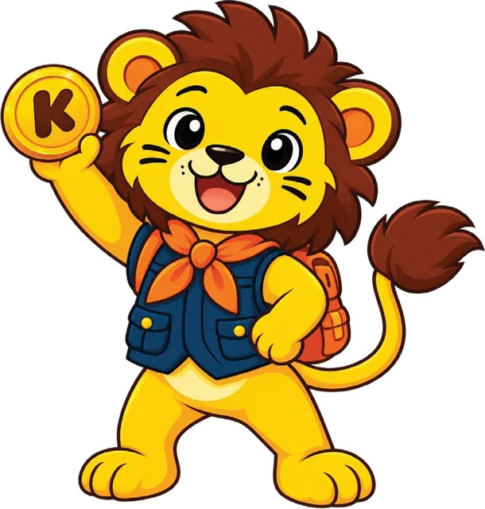
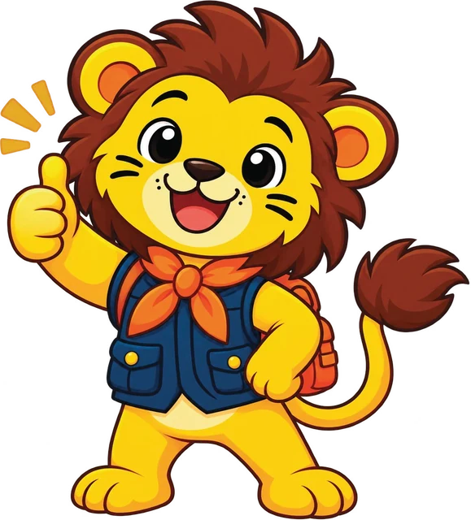
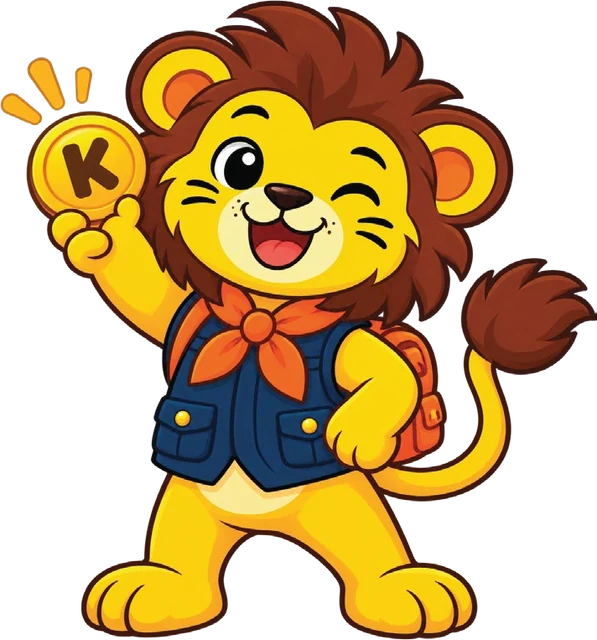
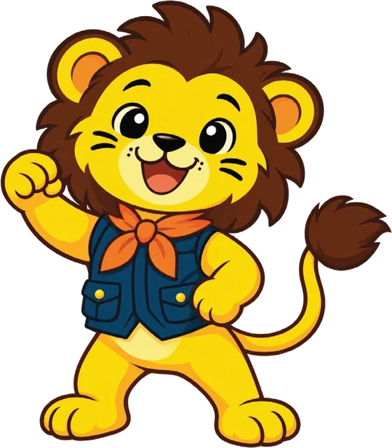
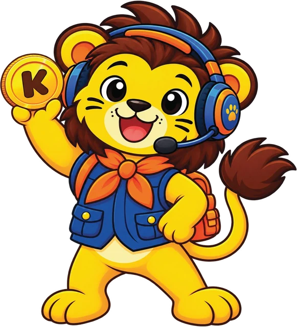

# Kudi the Cub: Usage Rules

Kudi is KudiCubs' guide: **a lion cub** who welcomes each child into **the Pride** and plays
alongside them. Since round 1 (spec 003), Kudi is drawn **only with the five official poses** from
the client's brand guide. The 002 placeholder drawings have been removed.

**Related**: [brand.md §2](./brand.md#2-kudi-the-cub-the-five-supplied-poses) (files and
sources) and spec 003 FR-010, FR-025 and FR-038.

## Character

- **Who**: a young lion cub in a navy explorer vest with an orange neckerchief and backpack,
  holding a gold "K" coin. That's the client's design.
- **Personality**: warm, encouraging, curious and easily delighted. He celebrates effort as much
  as results. He's a friend and coach, never a teacher.

## The five poses and when to use each

| Pose | Image | State | Typical moments |
|---|---|---|---|
| `wave` |  | Greeting, and the **base pose** | Screen openings, Welcome, Home, Decision (thinking), welcome back after a long idle |
| `thumbs-up` |  | Correct | A coin found, a coin in the right jar, a right answer, tap-to-hear on badges |
| `celebrate` |  | Celebrate (**provisional**: no peace-sign pose was supplied, B2) | All found, all sorted, intro answered, Result, Summary, Reward, joining the Pride |
| `fist` |  | Encourage | Wrong jar ("Let's try a different jar!"), locked age card, idle hints |
| `headphones` |  | Narration playing | While any recorded line plays. It isn't shown while a line's recording is still pending. |

**Pose order** for one action (interaction-moments §2):

1. The reaction pose, for about 0.6 s.
2. `headphones` while the line plays.
3. Back to the base pose.

Tap-to-hear goes straight to `headphones`. With no line, the reaction holds for 1.2 s.

**There is no sad, angry or disappointed pose, and none may be created.** A mistake always gets
`fist` (encourage).

## Size and placement

- Kudi is 96–320 px wide, scaled **in proportion only**, inside a fixed 9 : 10 box. The five poses
  have slightly different proportions, and the box keeps the layout still when the pose changes.
- **One Kudi per screen**, beside the speech bubble (Soft Gold, the character highlight).
- Kudi never covers the main action, a choice or a coin.
- On parent and reviewer screens, Kudi appears only in the "You joined the Pride!" moment.

## Voice and lines

Kudi speaks only through **human recordings**: never text-to-speech, never a cloned or synthetic
voice (spec 003 FR-014).

- The lines are in [narration/lines.json](./narration/lines.json).
- The actor's script is [narration-script.md](./narration-script.md).
- The casting and recording brief is [voice-direction-brief.md](./voice-direction-brief.md).

Line rules:

- **4–6**: at most 8 seconds per line, one idea, positive, second person ("you").
- Praise effort and choices. Name the concept after the action, never before (Constitution II).
- Until a line is recorded, its caption shows with **"Recording pending"**.

## Never

- ❌ Never redraw, recolour, mirror, stretch, crop or add to the five supplied poses.
- ❌ Never scolds, frowns or looks disappointed. Never says "wrong", "no", "fail" or "oops" to 4–6.
- ❌ Never tells a child to spend, buy or hurry.
- ❌ Never sells anything in the parent area.
- ❌ Never shown smaller than 96 px, or with another product's mascot.
- ❌ Never speaks with a synthetic or cloned voice.

## Idle behaviour

| After | Kudi | Screen |
|---|---|---|
| 6 s | `fist` (encourage) | The main action gets a Mane Brown ring with a yellow glow, and **the screen's prompt replays** |
| 12 s | `fist` | A hint line replays |
| 20 s (long idle) | `wave` | A stronger pulse, and "Welcome back! Let's play!" (FR-038) |

Any tap resets the timer, and Kudi returns to the base pose.
