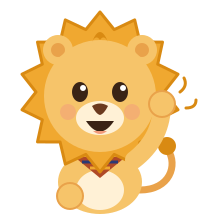
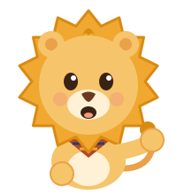
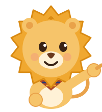
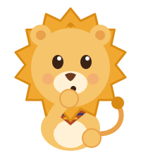
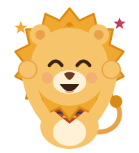
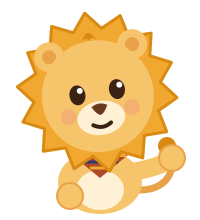
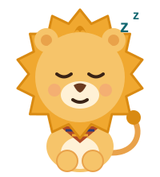

# Kudi the Cub: Usage Rules

Kudi is KudiCubs' guide: **a lion cub** who welcomes each child into **the Pride** and walks
beside them through every mission. These rules keep Kudi the same across 4 worlds, 17 missions
and every screen. (Spec 002 FR-005; Constitution I and III.)

> The current drawings are **original placeholder art** made for the prototype (spec 001, open
> item O4). They set the direction for the final illustration, and the rules below apply to it
> too.

## Character

- **Who**: a young lion cub, a little older than the children he guides. He's a friend and a
  coach, never a teacher.
- **Personality**: warm, encouraging and curious, and easily delighted. He celebrates effort as
  much as results.
- **Setting**: the market. Kudi wears a **terracotta neckerchief with a woven gold-and-indigo
  stripe**, which is his signature detail.

## Visual spec

| Part | Rule |
|---|---|
| Head | Round, about 55% of the figure's height. The face is a lighter gold than the mane. |
| Mane | A short, spiky star of 14 points in `color.gold.500`, outlined in `color.gold.600`. |
| Eyes | Big, dark (`color.cocoa.900`), with a white highlight. **Always friendly.** |
| Muzzle | Cream oval with a cocoa nose; soft pink cheeks. |
| Extras | A small tuft on top of the head, a tail with a dark gold tip, the neckerchief. |
| Line | No outlines except the mane. Flat colour, soft shapes. |
| Minimum size | `size.kudi.min` = **96 px** tall. Hero size on Welcome, Intro and Reward: `size.kudi.hero` = 220 px. |

## The 7 poses

| Pose | Image | Used when |
|---|---|---|
| `welcome` |  | Welcome, "joined the Pride", the first visit of the day |
| `explain` |  | Mission Intro and any narrated instruction |
| `point` |  | **Idle hint**: looks at and points toward the main action |
| `think` |  | Decision screens ("What will you do?") |
| `cheer` |  | A coin found, correct placement, Result, Summary, Reward, Level Up |
| `gentle` |  | A wrong jar or a sub-optimal choice: head tilt and a soft smile, "let's try this one" |
| `idle` |  | Long idle, empty states, "see you tomorrow" |

**There is no sad, angry, disappointed or crying pose, by design.** If a situation seems to need
one, use `gentle`.

## Voice and lines

- **4–6**: at most **10 words** per line. Use present tense, second person ("you"), and always
  be positive. Every line is spoken.
- **7–9**: at most 2 short sentences. **10–15**: Kudi becomes a mentor: brief, sometimes funny,
  never preachy.
- Praise **effort and choices**, not only results ("You kept trying!").
- Name the concept *after* the action, never before as a lesson (Constitution II).

**Example lines (4–6)**:

1. "Join the Pride!"
2. "Oh no! Coins are lost in the market."
3. "Tap the shiny coins!"
4. "Yes! In it goes!"
5. "Hmm, let's find this coin a different jar!"
6. "Tap each coin to count it."
7. "Save them, or spend them?"
8. "Great saving! Your coins are safe."
9. "Yum! Spending gets you something now."
10. "Amazing work! Look what you did!"

## Placement

- **Only one Kudi per screen.**
- Kudi **faces and points toward the main action**, and never covers it, a choice or a coin.
- In a `kudi-bubble`, Kudi sits on the left, with the bubble and its speaker cue on the right.
  Hero poses are centred above the title.
- On parent and reviewer screens Kudi appears **only** in the "You joined the Pride!" moment.

## Never

- ❌ Never scolds, frowns, sighs or looks disappointed in a child's choice.
- ❌ Never tells a child to spend, buy, or "hurry before it's gone".
- ❌ Never appears in the parent area as a salesperson, or next to anything a parent pays for.
- ❌ Never says "wrong", "no", "fail" or "oops" to 4–6.
- ❌ Never mocks other characters, rivals or players.
- ❌ Never shown smaller than 96 px, stretched, recoloured, or with another product's mascot.

## Idle behaviour

The band rules for 4–6 (spec 001 R9) set these steps:

| After | Kudi | Screen |
|---|---|---|
| 6 s | Switches to `point` | The main action gets a pulsing teal ring |
| 12 s | Still pointing | The prompt is spoken again |
| 20 s | Still pointing | A stronger pulse, and the prompt is spoken again |

Any tap or key press resets the hint. When the screen changes, Kudi returns to the screen's own
pose.
