# Round 1: What Changed, Screen by Screen

**For**: Jefferson Agbai (client).

**Prototype**: v0.1.0 → **v0.2.0**.

**Your round-1 feedback**:

1. Apply the official KudiCubs brand.
2. Replace the robot voice with a natural human voice.
3. Make it more interactive.

Each screen below shows **before** (left) and **after** (right), with what changed. The images
are generated by `tools/design/capture-before-after.mjs`.

> **About the voice**: the human recordings haven't been made yet. Until they are, each line
> shows its words with a **"Recording pending"** badge. The robot voice has been removed
> completely.

## Welcome

| Before (v0.1.0) | After (v0.2.0) |
|---|---|
| 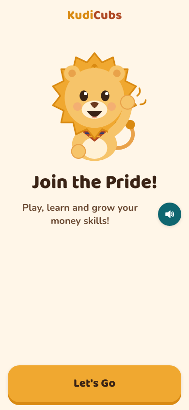 | 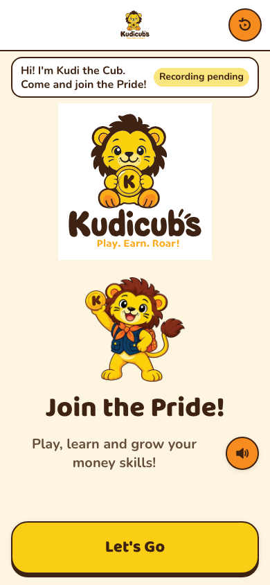 |

- **🎨 Brand**: The official KudiCubs logo (the cub holding the K coin, with "Play. Earn. Roar!") replaces the placeholder wordmark.
- **🎨 Brand**: Kudi is now your official mascot (the wave pose). The placeholder cub drawing is gone.
- **🎙️ Voice**: The robot voice is removed. Kudi's line will be a real recorded voice; until then it shows "Recording pending".
- **👆 Interaction**: Tap Kudi to hear "Hello, friend!", or tap the logo to hear "Play. Earn. Roar!".

## Age selection

| Before (v0.1.0) | After (v0.2.0) |
|---|---|
| 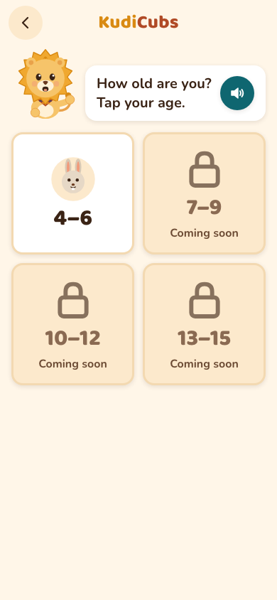 | 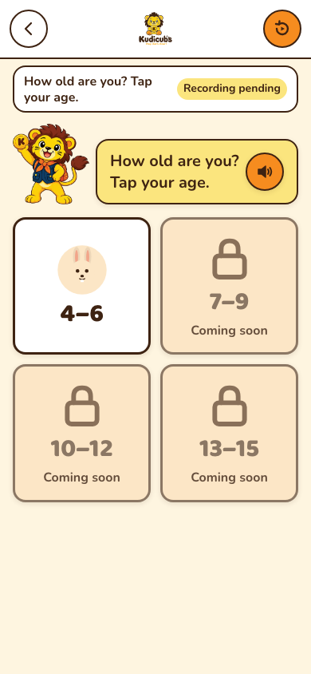 |

- **🎨 Brand**: Yellow and white cards with Mane Brown outlines, in the brand colours.
- **👆 Interaction**: Each age card speaks when tapped; Kudi gives a thumbs up, or a gentle fist for "coming soon".

## Pick a friend

| Before (v0.1.0) | After (v0.2.0) |
|---|---|
| 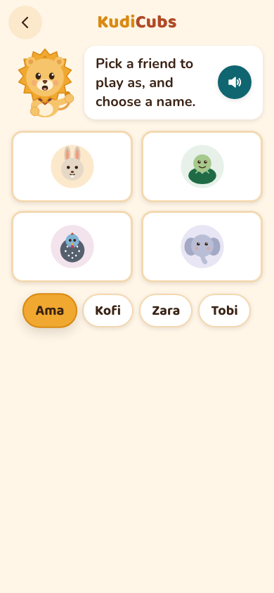 | 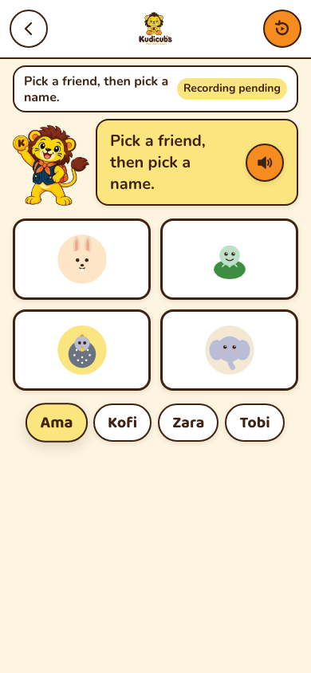 |

- **👆 Interaction**: Each friend introduces themselves when tapped ("Hi! I'm Hopper the hare!"); each name chip says the name.
- **🎨 Brand**: The selected card is highlighted in Soft Gold, the brand's character highlight.

## For grown-ups

| Before (v0.1.0) | After (v0.2.0) |
|---|---|
| 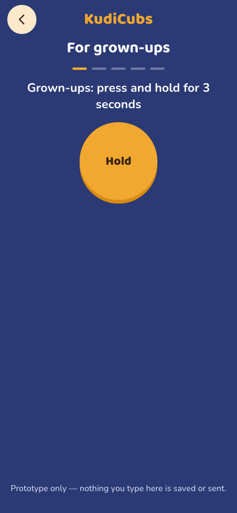 | 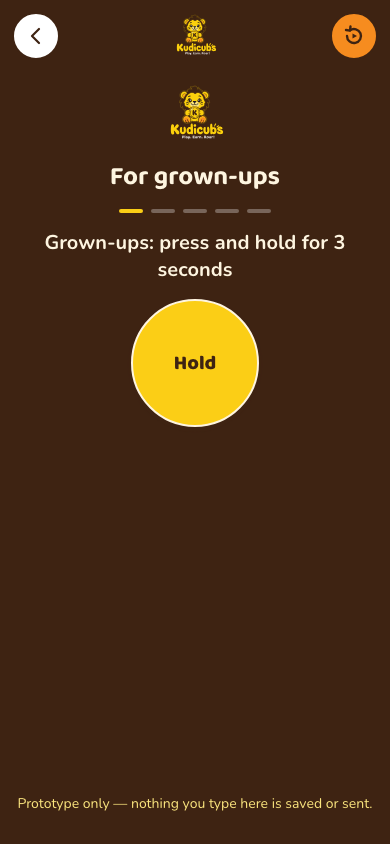 |

- **🎨 Brand**: The grown-up screens are now Mane Brown with the official logo on brown (previously indigo).
- **🎨 Brand**: The hold button and keypads use Sunshine Yellow and Warm Cream on Mane Brown.

## Home

| Before (v0.1.0) | After (v0.2.0) |
|---|---|
| 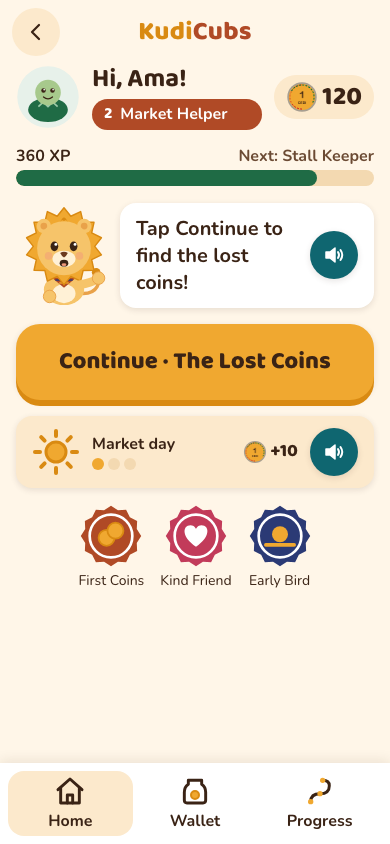 | 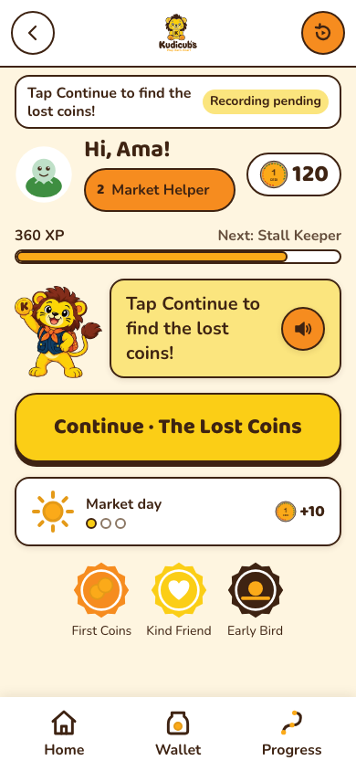 |

- **🎨 Brand**: A white header with the logo; the yellow Continue button with a Mane Brown outline; Golden Orange coins with brown rims.
- **👆 Interaction**: Tap your coins, a badge, your level or the market-day sun to hear it.
- **🎙️ Voice**: A replay button (↻, top right) on every screen repeats what Kudi last said.

## Mission intro

| Before (v0.1.0) | After (v0.2.0) |
|---|---|
| 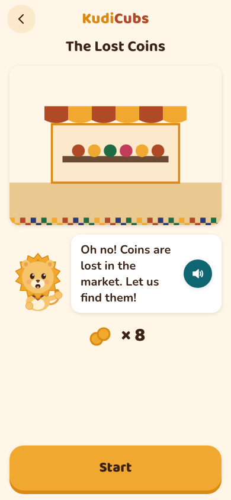 | 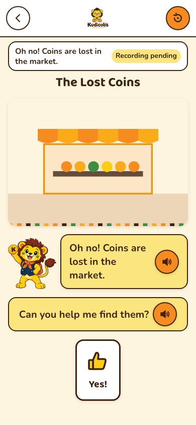 |

- **👆 Interaction**: Call and response: Kudi asks "Can you help me find them?" and the child taps 👍 before Start appears.
- **👆 Interaction**: Tap the market stall to hear "The market!".

## Find the coins

| Before (v0.1.0) | After (v0.2.0) |
|---|---|
| 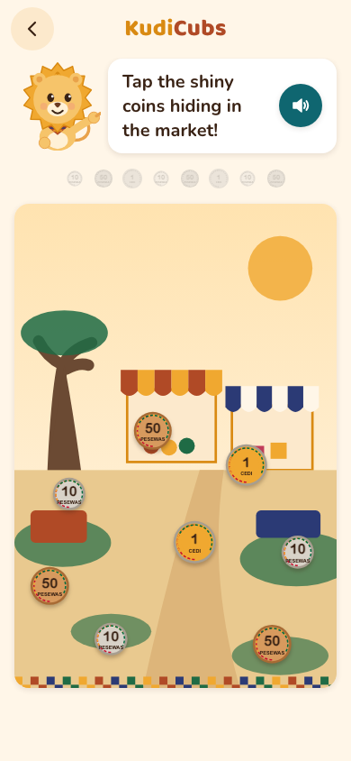 | 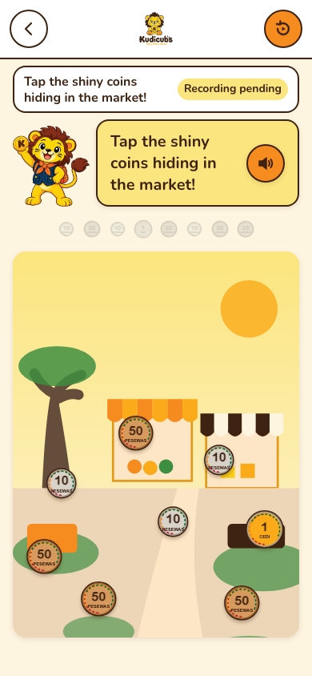 |

- **👆 Interaction**: Every coin says its name when found ("Fifty pesewas!"), with a pop sound and Kudi's thumbs up.
- **🎨 Brand**: The scene and coins use the brand palette; coins have Mane Brown rims.

## Sort into jars

| Before (v0.1.0) | After (v0.2.0) |
|---|---|
| 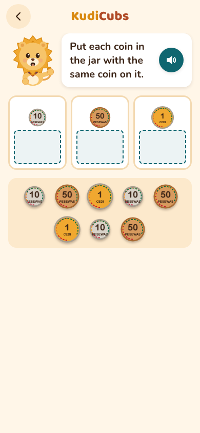 | 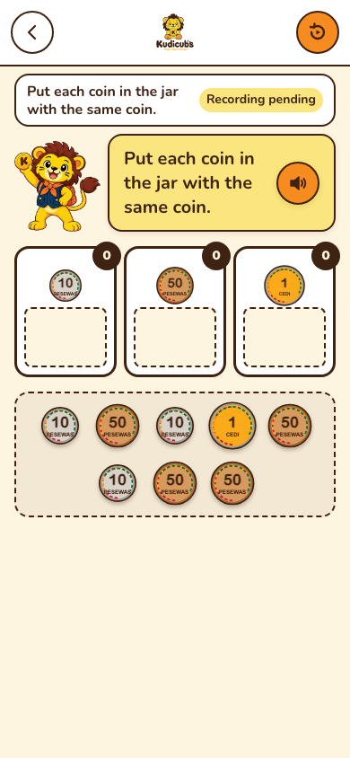 |

- **👆 Interaction**: Coins are dragged by hand into the jars. Each jar has a count badge that goes up by one with every coin.
- **👆 Interaction**: Right jar: a chime and thumbs up. Wrong jar: the coin floats back, Kudi's fist ("Let's try a different jar!") and a soft boop. Never a failure.

## Count the coins

| Before (v0.1.0) | After (v0.2.0) |
|---|---|
| 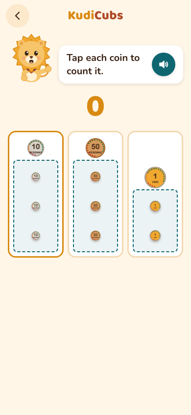 | 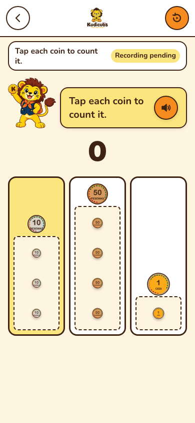 |

- **👆 Interaction**: Each tapped coin says its number ("One! Two! Three!").
- **👆 Interaction**: Call and response: "Which jar has the most coins?" The child taps a jar. A wrong guess gets a kind "Let's look again".

## Save or spend

| Before (v0.1.0) | After (v0.2.0) |
|---|---|
| 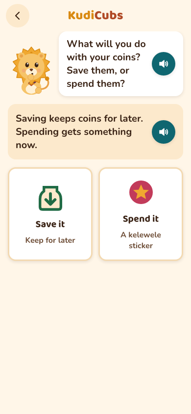 | 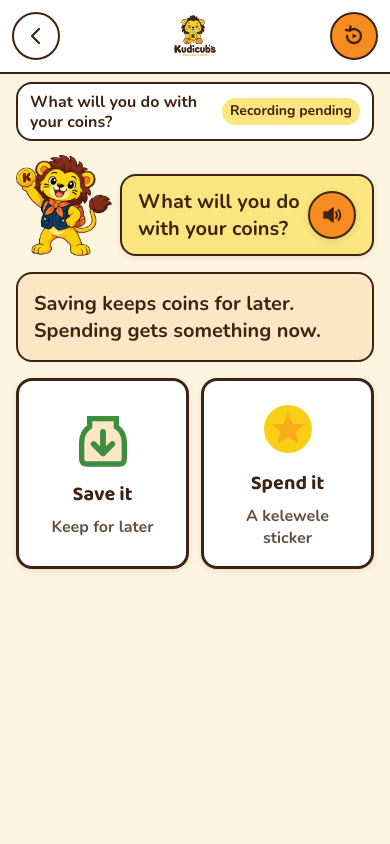 |

- **👆 Interaction**: Each choice card speaks when tapped ("Save them for later!" / "Spend them on a kelewele sticker!").
- **🎙️ Voice**: The treat changes by country: kelewele (Ghana), puff-puff (Nigeria), biscuit (UK).

## Result: save

| Before (v0.1.0) | After (v0.2.0) |
|---|---|
| 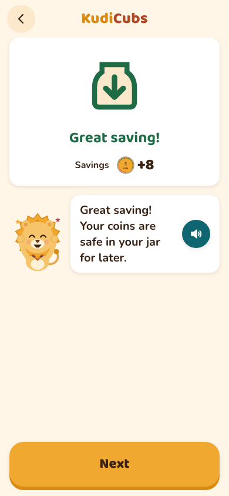 | 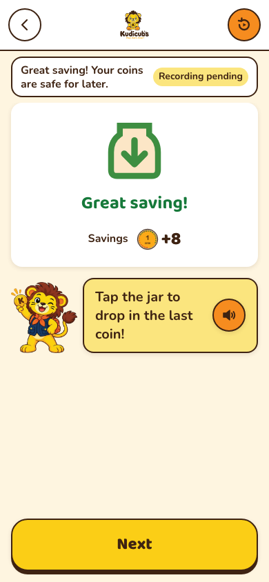 |

- **👆 Interaction**: The child taps the jar to drop in the last coin, with a sparkle and Kudi celebrating.
- **🎨 Brand**: The positive message uses the proposed success green (pending your approval).

## Result: spend

| Before (v0.1.0) | After (v0.2.0) |
|---|---|
| 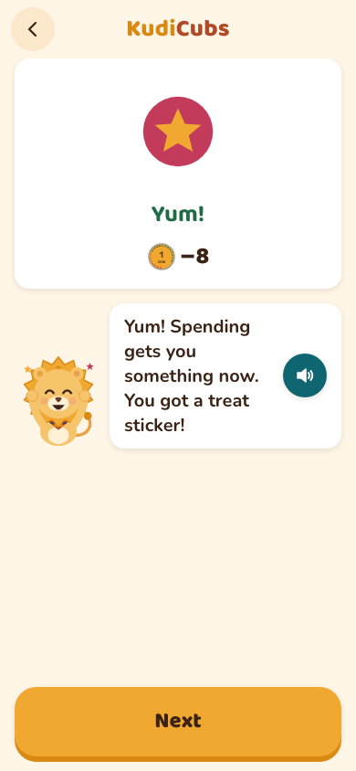 | 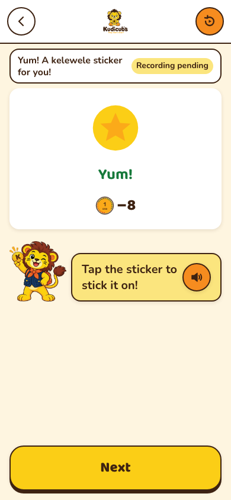 |

- **👆 Interaction**: The child taps the sticker to stick it on. Spending is still a happy choice.

## Summary

| Before (v0.1.0) | After (v0.2.0) |
|---|---|
| 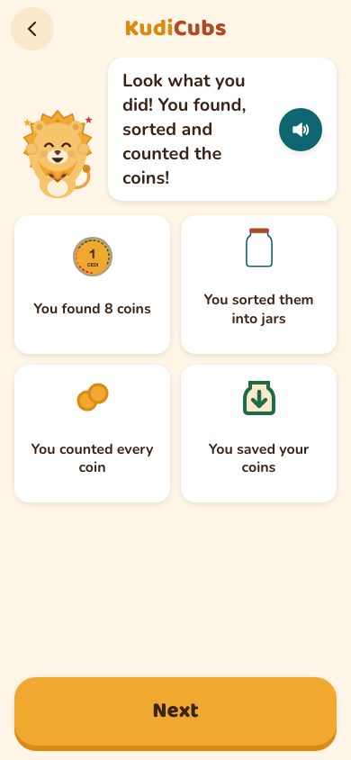 | 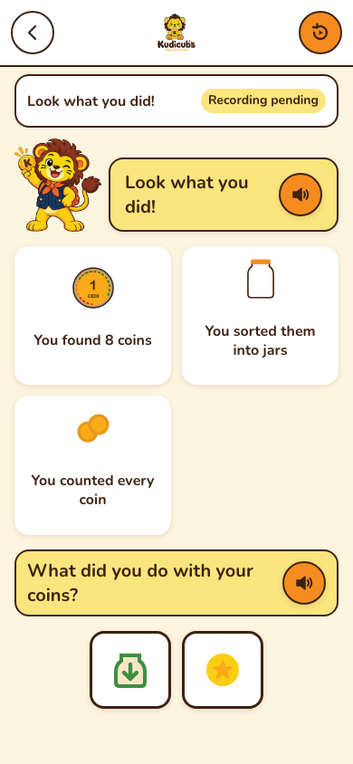 |

- **👆 Interaction**: Call and response: "What did you do with your coins?" The child taps the save or spend picture.
- **👆 Interaction**: Each recap tile says what the child did when tapped.

## Reward

| Before (v0.1.0) | After (v0.2.0) |
|---|---|
| 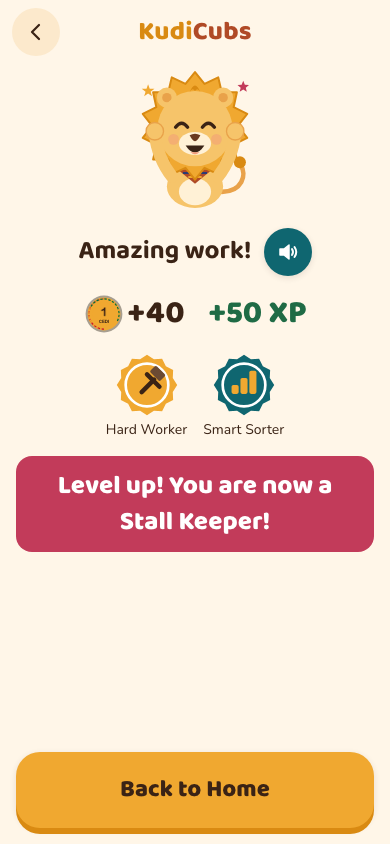 | 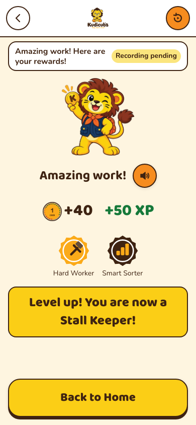 |

- **👆 Interaction**: Tap the reward burst to pop the celebration again ("Woo-hoo!"); tap a badge to hear its name.
- **🎨 Brand**: Kudi's celebrate pose, the brand-yellow Level Up banner, and Golden Orange coins.

## Wallet

| Before (v0.1.0) | After (v0.2.0) |
|---|---|
| 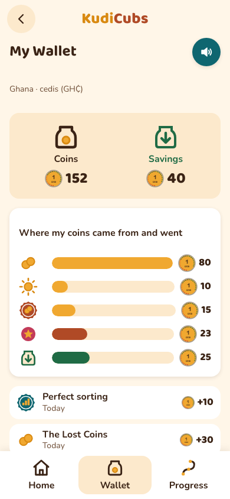 | 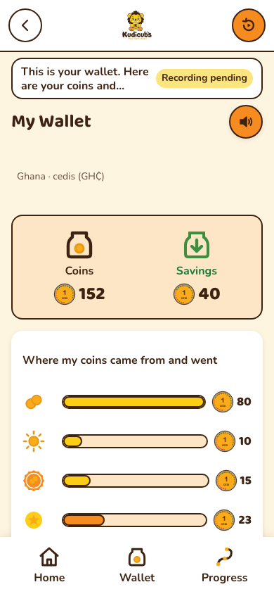 |

- **🎙️ Voice**: Kudi names the money for each country ("These are Ghana cedis and pesewas.").
- **👆 Interaction**: Tap any bar or history line to hear it.

## Progress

| Before (v0.1.0) | After (v0.2.0) |
|---|---|
| 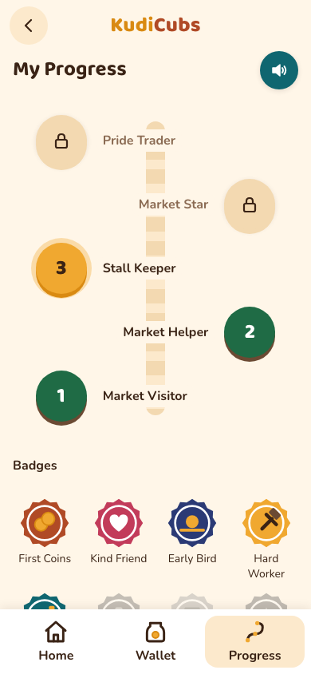 | 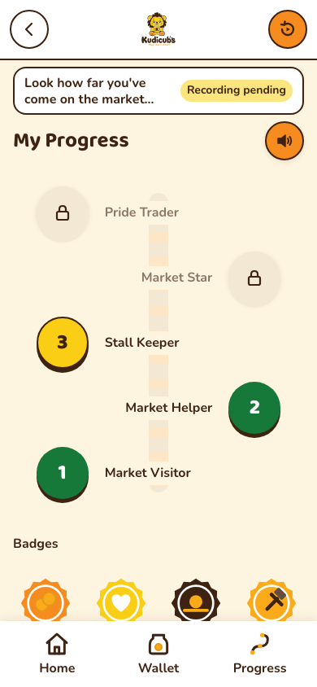 |

- **👆 Interaction**: Tap a level, badge or pillar to hear its name.
- **🎨 Brand**: The market-road level path in brand colours; the current level is Sunshine Yellow.

## Decisions we need from you

1. **B1 Yellow logo tagline**: The yellow logo version has a white tagline, which is hard to read. Is there a version with a Mane Brown tagline, or shall we keep using the white and brown logo versions?
2. **B2 Peace-sign pose**: You asked for a "peace sign" pose for celebrating, but none of the five poses shows one. Can we use the wink pose with the sparkling coin, or will you send a peace-sign pose?
3. **B3 Success green**: The guide asks for a separate green for success messages. We propose #16793A. OK?
4. **B4 Warm Cream**: The guide prints the Warm Cream code as #F68C1F (that's the orange). We used the swatch colour, #FEF5E0. Correct?
5. **B5 Charcoal**: The guide says #000000, but the swatch looks like #231F20. Which one? (It isn't used in the app yet.)
6. **B6 Button pressed shades**: We made slightly darker versions of yellow and orange for pressed buttons, and a lighter brown for small text. Are you happy with them? (See brand.md.)
7. **B7 Product name in text**: Should app text say "KudiCubs", "Kudicubs" or "Kudicub's" (as in the logo)?
8. **B8 Master files**: Please send the original logo (vector) and the five mascot images (transparent PNG) for the final app.
9. **B9 App fonts**: We propose Baloo 2 and Nunito (free, licensed for apps) for buttons and text, to match the rounded logo. OK?
10. **B10 Placeholder art colours**: Our draft coins and scenes use a few extra colours (silver, bronze, flag colours on coins, greens). OK until final illustrations?
11. **B11 App icon**: For the phone home-screen icon we used just the cub and K coin from your yellow logo (the full logo is too small to read at icon size). Nothing is redrawn. OK, or would you prefer the full logo?
12. **V1 First voice**: Shall we record Ghanaian English first, with a warm female storyteller voice?
